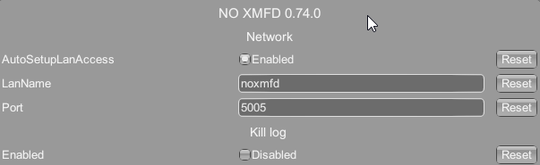

# Networking & LAN setup

NO XMFD runs a small HTTP/SSE server inside the game (default port **5005**) and serves the
MFD web UI from it. You open that UI in a browser:

- **On the same PC** — `http://localhost:5005/` — works out of the box, no setup.
- **On a tablet/phone/another PC on your Wi-Fi** — `http://<game-pc-ip>:5005/` — needs the
  two Windows gates below opened once. On Linux (Proton), see [Linux](#linux-proton) instead.

The game PC's URLs are on the MFD **MAIN** page: the name URL, and the LAN IP behind **URL not
working? Check here** (as **NET**). If MAIN only lists localhost, the wildcard bind was denied and
only localhost is served — work through the steps below.

## Why two gates

For a tablet to reach the server, **two independent** Windows permissions must both be granted.
Granting one but not the other leaves the connection broken:

| Gate | What it controls | Symptom if missing |
|------|------------------|--------------------|
| **URL reservation** (HTTP.sys) | Whether the process may *bind* the wildcard address `http://+:5005/` | Server falls back to localhost-only; MAIN shows no LAN URL |
| **Firewall rule** | Whether inbound LAN packets *reach* port 5005 | MAIN shows a LAN URL, but the tablet's connection times out |

Windows normally shows a firewall "allow this app?" prompt the first time something listens on
a port — but the game launches under Steam (non-interactive), so that prompt often never appears
and the rule has to be added by hand.

## Option A — let the mod do it (run as Administrator once)

The mod can add both gates itself, but **only when the game runs elevated** (netsh needs admin):

1. Make sure `AutoSetupLanAccess` is `true` (it is by default — see [Config](#config)).
2. Launch Nuclear Option **as Administrator** once (right-click → Run as administrator, or via
   an elevated Steam).
3. On that launch the mod adds the URL reservation + firewall rule (they **persist**), so from
   then on you can launch the game normally and LAN access keeps working.

Check `BepInEx/LogOutput.log` for `LAN auto-setup: urlacl=ok, firewall=ok` to confirm.

## Option B — add the gates manually (one time)

Open **PowerShell as Administrator** and run both (adjust the port if you changed it):

```powershell
netsh http add urlacl url=http://+:5005/ user=Everyone
netsh advfirewall firewall add rule name="NOXMFD (5005)" dir=in action=allow protocol=TCP localport=5005
```

Then launch the game normally. These persist across reboots; you only do this once.

> On a non-English Windows, `user=Everyone` may not resolve. Use the locale-independent SID form
> instead: `netsh http add urlacl url=http://+:5005/ sddl=D:(A;;GX;;;WD)`

## Connecting the tablet

1. Put the tablet on the **same Wi-Fi** as the game PC, on a **Private** network profile (not
   Public — Public blocks inbound LAN by default).
2. Open a LAN URL from MAIN: the name URL (`http://<name>.local:5005/`) or the IP URL
   (e.g. `http://192.168.1.42:5005/`, under **Check here** as **NET**). The name URL keeps working when the PC's IP changes, so
   it's the one to bookmark — see [A URL that doesn't change](#a-url-that-doesnt-change).

## A URL that doesn't change

Your router can hand the game PC a different IP from time to time, which breaks a bookmarked
`http://192.168.1.42:5005/`. MAIN also shows a **name URL** that follows the PC instead of its IP:

- **`http://noxmfd.local:5005/`**, by default. The mod answers for the name in `LanName` (see
  [Config](#config)) itself. Change it to any name you like; if two PCs on the same network run
  the mod, give each a different name (`noxmfd`, `noxmfd2`).

  
- **Your PC's own name**, e.g. `http://gaming-pc.local:5005/`, when `LanName` is cleared. Windows
  answers for its own name on the local network. The name is the one in Settings › System › About;
  a default like `DESKTOP-7F3K2QX` works but is easier to remember after renaming it. MAIN shows no
  name URL when the PC's name has characters a web address can't use (e.g. `_`).

Name URLs use mDNS (`.local` lookups). iPhone, iPad, Mac and Windows devices resolve them on their
own, as do recent Android versions; older Android and some smart-TV browsers don't. On a device
that can't open the name URL, use the IP URL. On a Windows device, the first visit can take a
couple of seconds while the name is looked up.

If MAIN shows `noxmfd` (or your chosen name) but other devices can't open it, Windows Firewall is blocking the
lookups from reaching the game. Steam usually allows the game through when it first runs; if not,
in **PowerShell as Administrator**:

```powershell
netsh advfirewall firewall add rule name="NOXMFD mDNS" dir=in action=allow protocol=UDP localport=5353
```

A **DHCP reservation** in your router (it always gives the game PC the same IP) works on every
device, name lookups or not. It's a router setting, usually under LAN / DHCP — look for "address
reservation" or "static lease".

## Linux (Proton)

Under Proton the two Windows gates don't apply: the server binds all interfaces on its own and
MAIN shows the LAN URL with no setup, so skip Options A and B. The gate that remains is the Linux
firewall. Linux Mint ships **ufw**; when it's active, its default policy silently drops incoming
connections, so the tablet's browser times out (`ERR_CONNECTION_TIMED_OUT`) even though `ping` to
the game PC works (ufw allows ping).

On the game PC, check the firewall and open the port to your home network:

```bash
sudo ufw status
sudo ufw allow from 192.168.0.0/16 to any port 5005 proto tcp
```

`Status: inactive` means ufw isn't what's blocking you. After the `allow`, `sudo ufw status` lists
`5005/tcp  ALLOW  192.168.0.0/16`; it takes effect immediately. The `from 192.168.0.0/16` limits
the port to LAN addresses. If your network uses `10.x.x.x` addresses, use `10.0.0.0/8` instead.

On distros that use firewalld (Fedora, openSUSE):

```bash
sudo firewall-cmd --permanent --add-port=5005/tcp
sudo firewall-cmd --reload
```

To remove the ufw rule: `sudo ufw delete allow from 192.168.0.0/16 to any port 5005 proto tcp`.

### Still not connecting

Run these with the game running, on the game PC unless noted:

| Check | Expected | If not |
|-------|----------|--------|
| `ss -ltn \| grep 5005` | `0.0.0.0:5005` | Server isn't listening on the LAN — check `BepInEx/LogOutput.log` for `LAN access:` |
| `hostname -I` | Includes the IP shown on MAIN | Use the address from `hostname -I` on the tablet's network (a VPN or second adapter can change which one MAIN picks) |
| `curl -s http://<game-pc-ip>:5005/ \| head -3` | `<!DOCTYPE html>` | Same as the first row |
| `ping <game-pc-ip>` **from the tablet/laptop** | Replies | Devices aren't on the same network — guest Wi-Fi, a different SSID, or client isolation on the router |
| `sudo tcpdump -ni any tcp port 5005`, then reload the tablet page | Packets appear | The tablet's traffic never arrives — turn off any VPN or proxy on the tablet/its browser |

If packets arrive but the page still times out, the firewall is still dropping them — recheck
`sudo ufw status verbose`.

## Config

Under the `[Network]` section of `BepInEx/config/com.roque.NOXMFD.cfg` (editable live in the
BepInEx **F1** ConfigurationManager menu; all need a **game restart** to take effect):

| Key | Default | Meaning |
|-----|---------|---------|
| `Port` | `5005` | TCP port the server listens on. Change only if 5005 is taken; must match the URL you open on the tablet. |
| `LanName` | `noxmfd` | The name the mod answers for on your network, so `http://noxmfd.local:5005/` always reaches it. Letters, digits and `-` only. Empty = your PC's own name instead (`http://<pc-name>.local:5005/`). A config file from a version that already had this key keeps its value. See [A URL that doesn't change](#a-url-that-doesnt-change). |
| `AutoSetupLanAccess` | `true` | On first launch, if the LAN bind is denied, add the URL reservation + firewall rule automatically — **only works if the game is run as Administrator**. Set `false` to manage them yourself. No effect once configured. |

## Undoing the changes

```powershell
netsh http delete urlacl url=http://+:5005/
netsh advfirewall firewall delete rule name="NOXMFD (5005)"
netsh advfirewall firewall delete rule name="NOXMFD mDNS"
```

## Troubleshooting

- **MAIN shows no LAN URL** → URL reservation missing. Do Option A or B.
- **MAIN shows a LAN URL but the tablet can't connect** → firewall rule missing, tablet on a
  different network/subnet, or the PC is on a Public network profile. On Linux, it's usually ufw —
  see [Linux](#linux-proton).
- **`Failed to start on port 5005`** in the log → another app already owns the port. Change
  `Port` in the config (and reopen the tablet URL with the new port).
- **The name URL doesn't open, but the IP URL does** → the device can't resolve `.local` names
  (older Android), or the lookups are blocked — see [A URL that doesn't change](#a-url-that-doesnt-change).
- **Changed a setting, nothing happened** → `Port`, `LanName` and `AutoSetupLanAccess` are read at
  startup; restart the game.
- **Restarting or replacing the game process reports the old port still in use** → current NOXMFD
  builds cancel and abort active browser requests, close the listener, and confirm the configured
  port stopped listening during normal Unity shutdown. A replacement tool that overlaps the old and
  new processes should request NOXMFD's cooperative server shutdown before quitting the parent, then
  use a short bounded port-availability check for older builds or forced-exit cases.
