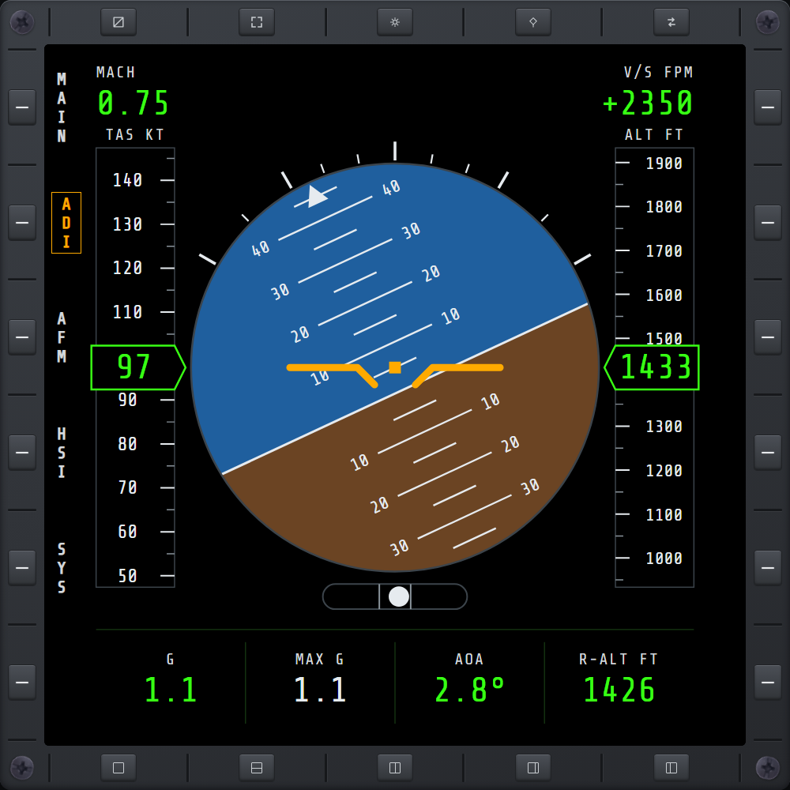

# ADI

Attitude at a glance, part of the **AVN** (Avionics) hub. Open it from MAIN's **AVN** key; the hub
opens on ADI, and **ADI / AFM / HSI / SYS** switch between its pages.

- **Attitude ball** — sky and ground with a pitch ladder (a line every 5°, numbered every 10°), a
  bank scale (10/20/30/45/60°) whose pointer turns with the ball, and the fixed amber aircraft
  symbol. The **slip ball** under it rolls toward the side the aircraft is slipping to.
- **Airspeed tape** (left) and **altitude tape** (right) — scroll past a boxed pointer that shows
  the exact value: true airspeed and altitude above sea level.
- **MACH** and **V/S** (vertical speed) in the top corners.
- **G**, **MAX G** (the highest G since the mission started), **AOA** (angle of attack) and
  **R-ALT** (radar altitude above the ground) along the bottom.

Units follow the game's own unit setting: knots, feet and feet per minute, or km/h, metres and
metres per second. AoA shows a dash below taxi speed, as the game's own readout does.

The ball's sky and ground colours are **ADI SKY** and **ADI GROUND** on the [UI](ui.md) page.
