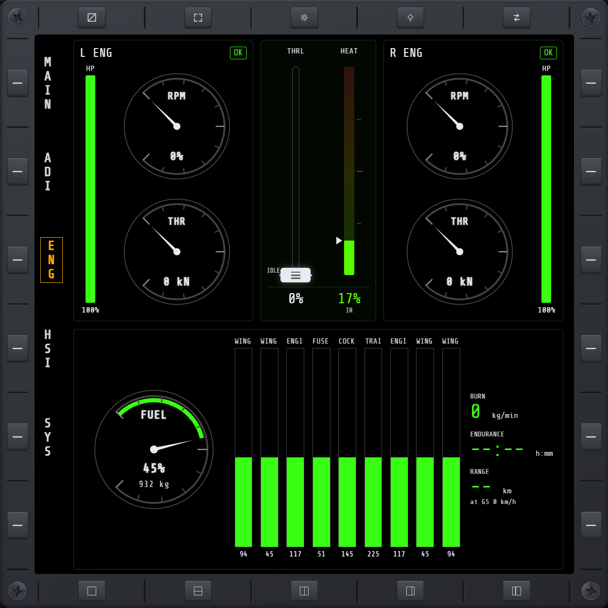
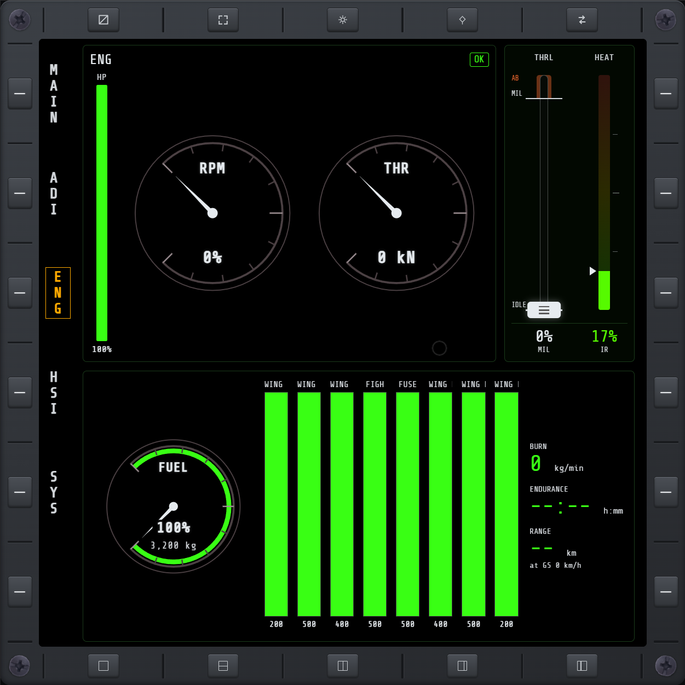
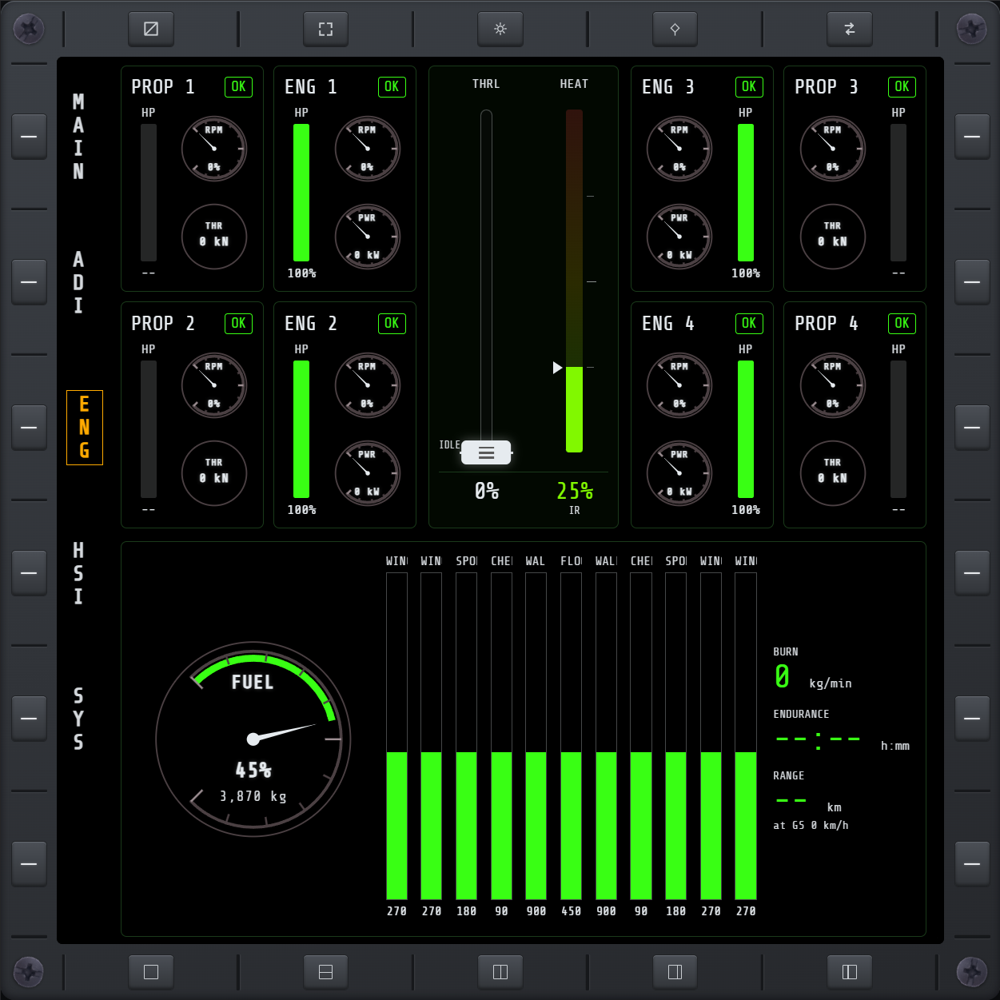

# ENG

Engines and fuel, part of the **AVN** (Avionics) hub.

## Engine cards

One card per engine, ordered left to right as they sit on the aircraft: **L ENG** / **R ENG** on a
twin, **ENG** on a single-engine aircraft, **ENG 1**, **ENG 2**… on three or more.

With more than two a side, the cards sit two abreast. Aircraft whose turbines drive propellers (the
Tarantula) list the propellers too, numbered on their own: **PROP 1**, **PROP 2**… A propeller card
shows its thrust as a number in kN, and HP reads `--`.

- **RPM** dial.
- **THR** dial in kN, or **PWR** in kW on helicopters, whose engines drive the rotor rather than
  push.
- **HP** tape: the engine's own health. Shows `--` on engine types the game doesn't rate.
- Status tag: **OK**, **FAULT** (amber: the engine has taken damage) or **INOP** (red: the engine
  is out). An engine blown off the aircraft keeps its card, reading INOP.

## Throttle and heat

Between the cards:

- **THRL**: a throttle lever. On aircraft with afterburner, the orange zone above the **MIL**
  detent is reheat, and the readout below shows **AB** in red while you're in it.
- **HEAT**: your IR heat signature, coloured like the game's own IR gauge.

## Fuel

- **FUEL** dial: fuel left across all tanks, with the mass under it.
- One bar per tank, tagged **LEAK** (amber) when punctured and **FIRE** (red) when burning.
- **BURN**: fuel used per minute, measured from how fast your total fuel drops, so a leak counts.
- **ENDURANCE**: time until empty at the current burn, h:mm.
- **RANGE**: distance you'd cover in that time at your current ground speed.

Burn, endurance and range read `--` for the first second or so after spawning or refuelling,
then settle within about ten seconds of a throttle change. Range shows `--` while you're taxiing
or parked. Units follow the game's Imperial/Metric setting.
