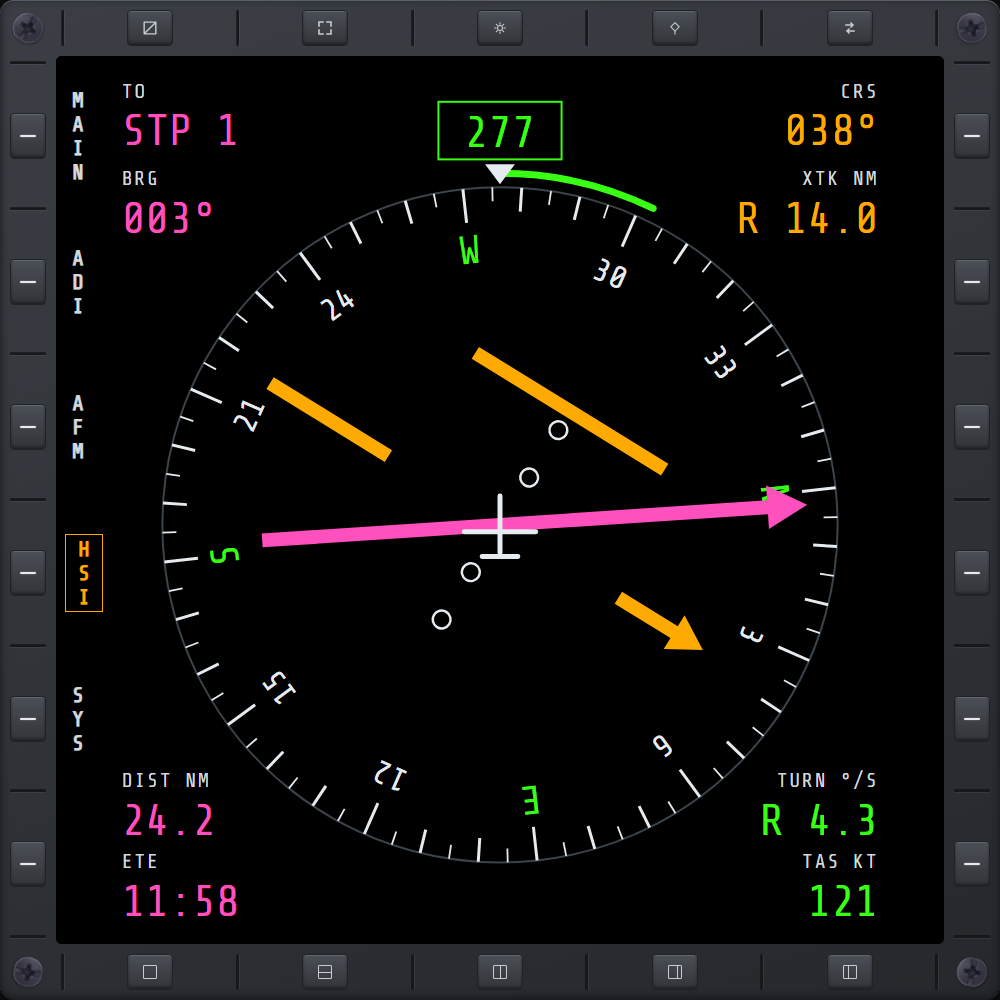

# HSI

Heading and navigation, part of the **AVN** (Avionics) hub. Open it from the hub's **HSI** key.

- **Compass rose** — turns under the fixed marker at the top; the boxed number is your heading.
  Headings are true: the game has no magnetic north.
- **Turn arc** (green, along the top of the rose) — where your heading will be in 6 seconds at the
  current turn rate.
- **Bearing pointer** (magenta) — points at your navigation target: the active route's next
  waypoint or, with no route active, the active steer point. It is the same target [WPT](wpt.md),
  RTD and the HUD cue use.
- **Course arrow and deviation bar** (amber) — the course to fly into the target. For a route, it
  is the leg from the previous waypoint. For a steer point or a route's first waypoint, which have
  no leg, it is the line from where you were when that target became active ("direct to"). The bar
  slides toward the course line when you drift off it: each dot is **1 nm** (2 km in metric), and
  past two dots it stops at the edge.
- **Corners**:
  - **TO** and **BRG** — the target (WPT n or STP n) and its bearing.
  - **CRS** and **XTK** — the course, and how far you are off it (**R** right of the line,
    **L** left).
  - **DIST** and **ETE** — distance to the target and time to reach it at your current airspeed.
  - **TURN** and **TAS** — turn rate (**R**/**L**, degrees per second) and true airspeed.

With no route or steer point active, the rose shows **NO NAV TARGET**, the navigation readouts show
a dash, and heading, the turn arc and turn rate keep working.
