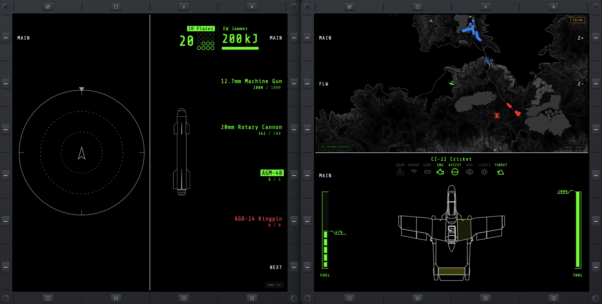
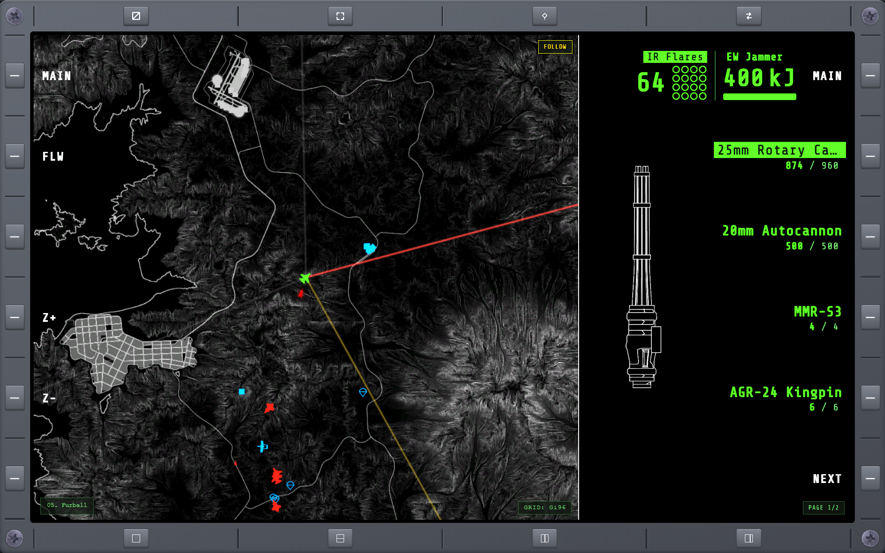
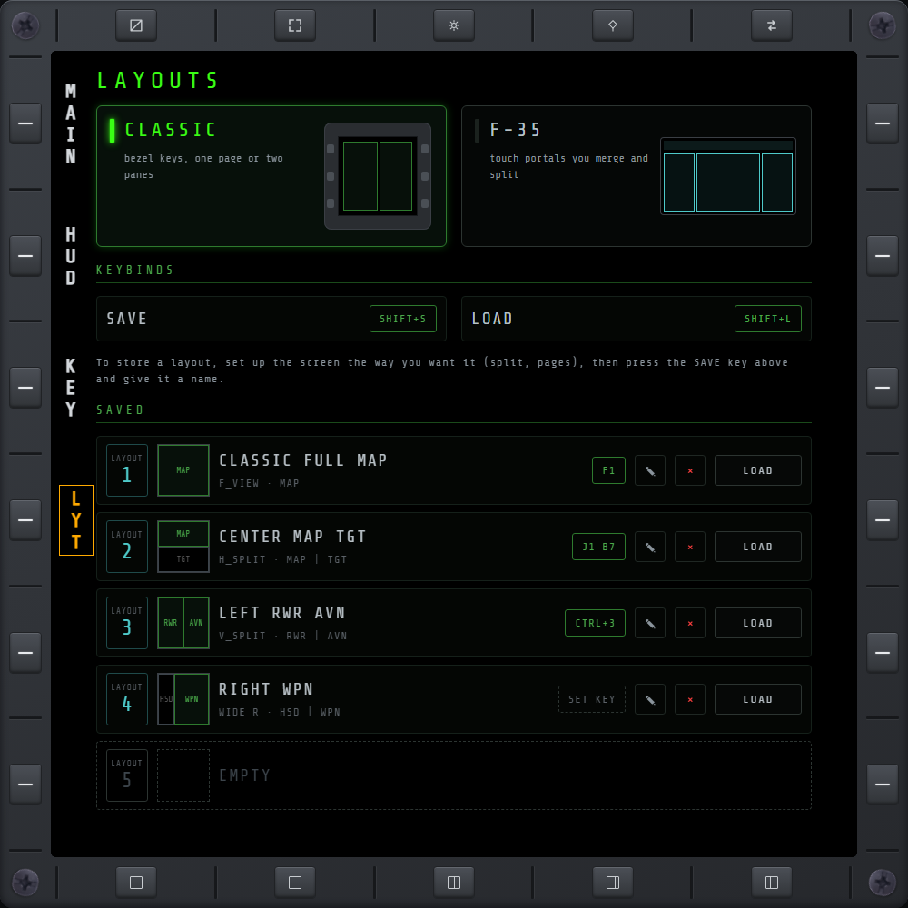
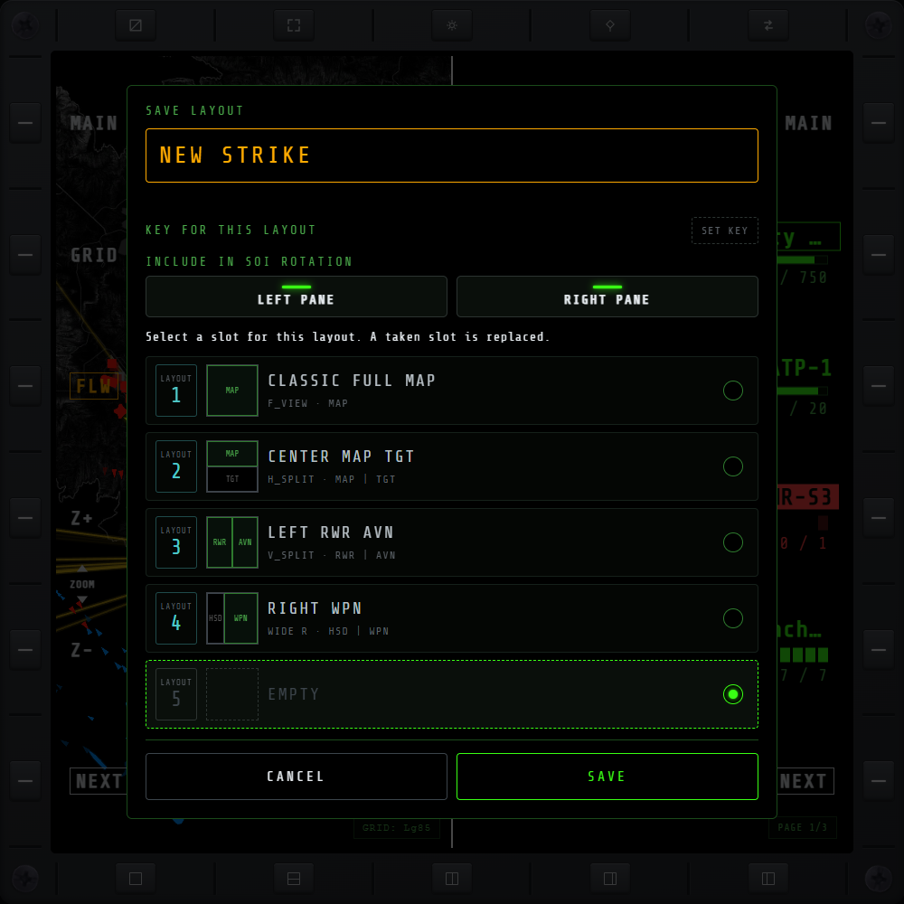
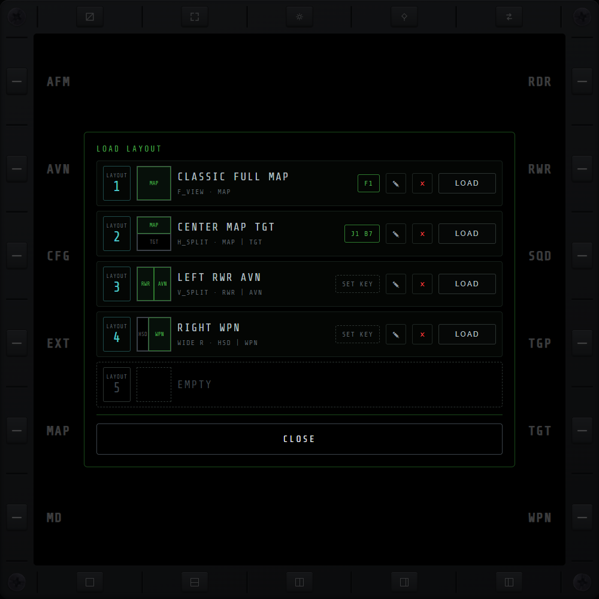

# LYT

NO XMFD can render in more than one shell layout — a different frame, navigation, and split model
over the same pages. Two are supported for now: **CLASSIC** and **F-35**.

## CLASSIC

The metallic bezel layout. A single active page fills the screen, or splits into two panes,
framed by dedicated bezel buttons — function controls along the top, layout presets along the
bottom.

**Function controls (top):**

- **HIDE** — hide the bezel so the screen fills the viewport.
- **FULL** — fullscreen toggle.
- **WAKE** — keep the screen from sleeping while NO XMFD is open. Off by default; lights amber
  while on. The preference is remembered by the browser and reapplies after a reload. If the
  device can't be kept awake at all, the key turns itself back off and **WAKE LOCK FAILED**
  briefly appears in the corner of the screen.
- **PIN** — pin the current layout: the split (or full view) and the page in every pane. **PINNED**
  shows in the corner while the screen matches it; press PIN again there to unpin. A full-view MAIN
  can't be pinned.
- **SWAP** — switch to the pinned layout, and back to the one you left on the next press.

**Layout presets (bottom):**

- **F_VIEW** — single page, full screen.
- **H_SPLIT** — top/bottom split.
- **V_SPLIT** — left/right split.
- **V_WIDE_SPLIT_L** — left/right split, 2:1, wide pane on the left.
- **V_WIDE_SPLIT_R** — left/right split, 2:1, wide pane on the right.

Each browser window keeps its own split, pages and PIN: a reload brings back what that window
showed, and a new window starts on a full-view MAIN.

## F-35

A borderless, touch-driven layout modelled on the real F-35's panoramic cockpit display: there
are no bezel keys — the navigation labels are drawn on the glass and tapped directly, and the
screen divides into side-by-side portals, each an independent MFD, that you merge and split with
corner grips. Each portal keeps a narrow column of glass beside its page for the labels, so they
never cover what the page shows; the grips sit at the bottom of those columns. MAP and TGP are the
exception: the map and the camera feed fill the whole portal and their labels sit on top. A fixed
strip across the top carries the **NO XMFD** wordmark with the connection address and status under
it (left), up to four widgets (middle), and **✎** (edit the strip), **WAKE** (keep the screen awake,
same as CLASSIC's WAKE key above) and **FULLSCREEN** (right). A dismissable red banner drops down from the strip on a
connection loss, above every portal regardless of page — see
[MAIN's Connection status](main.md#connection-status).

### Editing the top strip

The middle of the strip has four slots, each holding one widget you choose; the left and right
blocks are fixed. Each widget takes the width it needs, spread evenly across the strip; if they
don't all fit, THRL / FUEL and RPM / HEAT narrow first, then the right-most widget is cut off and
the row scrolls sideways (hover the strip for its scrollbar). The strip is always just tall enough
for its contents, on a phone in landscape or a big screen. A new window starts with THRL / FUEL and
the avionics flags. Tap **✎** to edit: all four slots show, each with a dashed box.

- An empty slot shows **+** in the middle — tap it to pick a widget for that slot:
  - **THRL / FUEL** — the throttle and fuel gauges;
  - **RPM / HEAT** — the engine RPM and heat gauges; HEAT's bar takes the cockpit IR gauge's colour,
    as on AVN;
  - **AVIONICS FLAGS** — the eight avionics flags, each a toggle button: its name, a lamp and its
    icon, the lamp and icon lit green when on (GEAR red when down). Tap one to toggle it, as on AVN;
  - **WPN MODES** — the selected weapon's name, its ammo gauge (as on WPN: a mark per round, or a
    bar for the cannon) and its round count, red when it's out; then two switches, **MASTER**
    (SAFE / ARM) and **MODE** (A/A / ALL / A/G). Tap a
    switch to step it to the next state to the right; from the last it goes back to the first. The
    lit state is the game's: SAFE red, ARM green, the mode amber;
  - **FLIGHT DATA** — **ALT**, **R-ALT**, **TAS**, **HDG**, **V/S**, **G** and **MACH**, in the
    game's units;
  - **CLOCKS** — local time, mission time and mission elapsed (the mission clocks read `--` in
    multiplayer).

  A widget already in another slot isn't offered.
- A filled slot shows **✕** in its top-right corner — tap it to empty the slot. The other widgets
  stay where they are.

Tap **✎** again to finish; empty slots then take no space. While editing, the flags don't toggle;
WAKE and FULLSCREEN keep working. **SAVE** stores the strip with the layout, so each saved F-35
layout can carry its own strip; a layout saved before the strip was editable leaves it as it is.

Each browser window keeps its own portals and strip: a reload brings back what that window showed,
and a new window starts with four MAIN portals and the strip's default THRL / FUEL and avionics
flags.

## The LYT page

**LYT** (MAIN → **CFG** → **LYT**) is the layout manager, the same page in either layout. On CLASSIC
its bezel keys are **MAIN** (top left, back to MAIN) and the CFG switch to **HUD**, **KEY** and
**[UI](ui.md)**. On F-35 it fills the glass under the strip; the portals keep running underneath. The
page has three parts:

- **LAYOUTS** — the two layouts as cards, the one you are on lit. Tap the other to switch to it, or
  the lit one to leave LYT (CLASSIC back to MAIN, F-35 back to its portals).
- **KEYBINDS** — the **SAVE** and **LOAD** layout keys. Click a box, then press the key you want
  (Esc cancels, Delete clears). One line under it reminds you how saving works.
- **SAVED** — the saved layouts of the layout you are on, one row each, in the order they were saved. A row shows its number,
  a small picture of the split (or F-35 portals) with the page in each pane, its name, and which split
  it is (on F-35, how many portals). The first
  five rows carry a **Layout 1-5** key box, and empty slots show as dashed **EMPTY** rows. A pane the
  layout leaves out of the SOI rotation is drawn gray in the picture. Each row also has:
  - a **key box** — click it, then press a key *or* a joystick button; a slot holds one or the other.
    This is the same setting as [KEY's Layout Presets](keybinds.md#layout-presets): pressing it loads
    whichever layout is in that position;
  - **✎** — edit the layout's name and choose which of its panes stay in the
    [SOI](keybinds.md#sensor-of-interest-soi) rotation (one lit toggle per pane, or one for a full view);
  - **×** — delete it (the ones below move up a slot);
  - **LOAD** — apply it now (on F-35 this also closes LYT).

## Save/Load Layout

Save the current arrangement — the split (or F-35 portal arrangement) and which page each pane or
portal shows — under a name, and load it back later. Saved layouts are kept on the game PC and
shared by every connected browser.

**CLASSIC**

- **Save Layout** key — set the screen up the way you want it, then press the key. A form opens:
  - a name;
  - a key for the layout (a keyboard key or chord);
  - **Include in SOI rotation** — one lit toggle per pane of the current screen (or **FULL VIEW**),
    starting from what is selected now;
  - the five slots. The first empty slot is selected, and the green button reads **SAVE**. Pick a
    taken slot instead and it reads **REPLACE** — the current screen replaces that layout and keeps
    its Layout key. When all five are taken you choose which one to replace.
- **Load Layout** key — opens the same **SAVED** rows as the LYT page: set keys, edit, delete, or **LOAD**.

**F-35**

- **Save Layout** — prompts for a name, then saves.
- **Load Layout** — lists every saved layout; pick one to apply it. A pencil renames and an × deletes.
  Above the list, one checkbox per portal ("Include portal N in SOI") removes that portal from
  [SOI Next/Prev](keybinds.md#sensor-of-interest-soi)'s cycle on this display. A layout whose portals
  were set on the LYT page's **✎** applies those SOI choices when loaded.

Each view keeps its own list, and **Layout 1-5** load the 1st-5th in the list of the view the browser
shows. Both keys are configured on the LYT page or on [KEY](keybinds.md#layout); they are keyboard-only
and apply to every connected browser.
