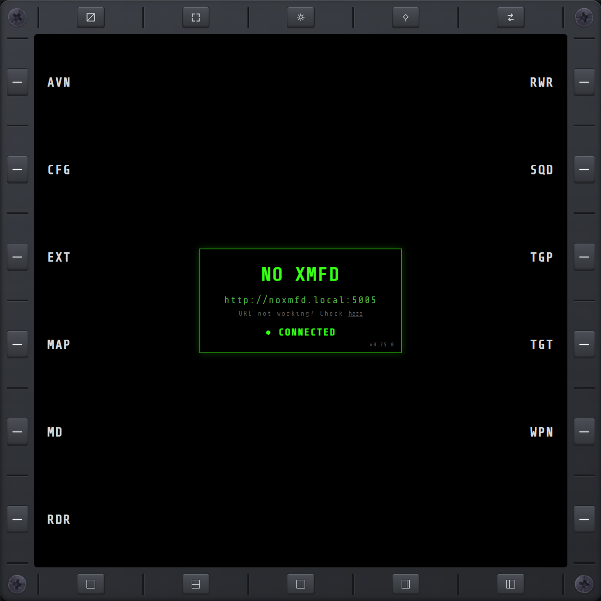

# MAIN

Landing page: connection status and the URL(s) to open the display.

## URLs

MAIN shows the **name address** (`http://noxmfd.local:5005` by default): the `LanName` setting, or
your PC's name if you clear it. It opens the display from other devices on your network and keeps
working when the PC's IP changes, so it's the one to bookmark. See
[NETWORKING.md](../NETWORKING.md#a-url-that-doesnt-change).

Under it, **URL not working? Check here** — tap **here** to show the two other addresses:

- **PC** — `http://localhost:5005`. Works from a browser on the same PC the game is running on.
- **NET** — the LAN address (e.g. `http://192.168.1.42:5005`). Works from other devices on your
  network, including ones that can't open the name address (older Android). It changes when the
  PC's IP does.

With no name address (LAN access off), MAIN lists the localhost address, plus the LAN address if
there is one, with no hint. If the LAN address is missing, the server fell back to localhost-only —
see [NETWORKING.md](../NETWORKING.md) for why and how to fix it.

The F-35 layout's top strip shows only the name address, or `http://localhost:5005` when there's
none.

## Connection status

- **● CONNECTED** — green. A mission is loaded — whether or not you've picked an aircraft yet.
  Live telemetry (position, weapons, etc.) only starts once you have.
- **● CONNECTED — no mission** — amber. The server is reachable and sending keepalives, but no
  mission is loaded (sitting at the main menu).
- **● DISCONNECTED** / **● DISCONNECTED — retrying…** — red. No telemetry has arrived in the last
  ~2.5 seconds — the game isn't running, the plugin hasn't started yet, or the connection dropped.
  The display keeps retrying on its own; nothing to do but wait or check the game/plugin is up.

A drop also shows a red banner across the top of whichever page you're on, so you don't have to be
looking at MAIN to notice — same on the F-35 layout's glass. Dismiss it with **✕**; it reappears on
the next drop, so dismissing one outage never hides a later one. It clears itself as soon as the
connection comes back, whether or not you dismissed it.
